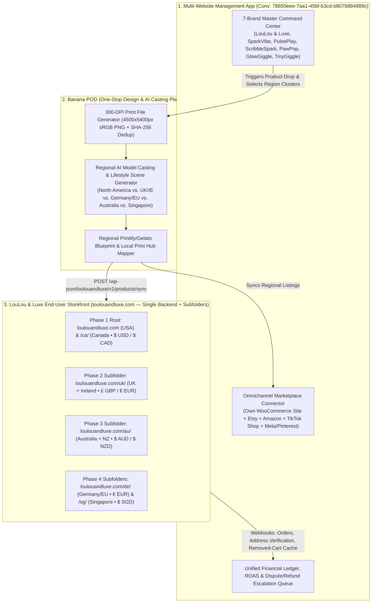

# Banana POD & Multi-Website Management App — Cross-System Integration & Regional Storefront Reference Guide

**Target Systems:**
1. **Multi-Website Management App (Owner Command Center):** [Conversation `78650eee-7aa1-45bf-b3cd-b807b884989c`](conversation://78650eee-7aa1-45bf-b3cd-b807b884989c) — Single-login administration for all 7+ brands across own WooCommerce websites, Etsy, Amazon, TikTok Shop, Pinterest, and Meta Shops.
2. **Banana POD (Central Graphic, AI Model Casting & Printify Engine):** One-stop design studio that creates 300-DPI artwork, region-specific AI model lookbooks, and pushes products to each brand's regional storefronts.
3. **LouLou & Luxe Storefront (`loulouandluxe.com` — [Conversation `eeef9e06-e51a-47b4-bf18-b6969fe51dc6`](conversation://eeef9e06-e51a-47b4-bf18-b6969fe51dc6)):** End-user B2C shopping storefront (`https://loulouandluxe.com`), launching **Phase 1 in USA + Canada (`US_CA`)** and expanding globally (`/uk/`, `/au/`, `/de/`, `/sg/`) on a **Single-Backend Root + Subfolder Architecture**.

---

## 1. Architectural Division of Labor (Zero Overlap)

---

## 2. URL & Backend Strategy: Single WooCommerce Instance with Root + Subfolders

Why we use **Root (`loulouandluxe.com` for USA & `/ca/` for Canada) + Subfolders (`/uk/`, `/au/`, `/de/`, `/sg/`)** instead of separate subdomains (`us.loulouandluxe.com`, `uk.loulouandluxe.com`):
1. **$0 Extra Licensing & Hosting Cost:** Runs on a **single WooCommerce installation and single PostgreSQL/MySQL database**, avoiding multi-domain plugin fees and saving 35–50% server RAM.
2. **Fastest Customer Page Load (`0ms` Redirect for North America):** USA + Canada shoppers hit `loulouandluxe.com` directly with zero DNS/SSL redirect penalty; subfolder switches reuse the same HTTP/3 connection and cached fonts/CSS.
3. **Single API Endpoint for Banana POD & Multi-Website Manager:** Both admin apps authenticate against **one** endpoint (`https://loulouandluxe.com/wp-json/loulouandluxe/v1/`) and control regional catalog isolation via the `region_clusters` array (`["US_CA"]`, `["UK_IE"]`, `["ANZ"]`, `["DE_EU"]`, `["SG_APAC"]`).

### 2.1 Strict Regional Catalog Isolation Rules (Each Market Catered To Differently)
* Every product in the database carries `region_clusters TEXT[]` (e.g., `ARRAY['US_CA']`).
* When a shopper visits `loulouandluxe.com` or `loulouandluxe.com/ca/` (North America), WooCommerce filters every query with `WHERE 'US_CA' = ANY(region_clusters)`.
* When a shopper visits `loulouandluxe.com/uk/` (UK & Ireland), WooCommerce filters with `WHERE 'UK_IE' = ANY(region_clusters)`.
* When a shopper visits `loulouandluxe.com/au/` (Australia & NZ), WooCommerce filters with `WHERE 'ANZ' = ANY(region_clusters)`.
* **US-only products are never shown to UK or Australian visitors, and UK/Australian products are never shown to US/Canada visitors.**

---

## 3. Global Brand Shell (85% Constant) vs. Regional Chameleon Layer (15% Localized)

### 3.1 What Must Remain 100% Identical Across All Regions (Managed in Storefront Theme)
* **Color Palette (Core UI Shell):**
  - Light Atelier: Warm Alabaster Canvas (`#FAF8F5`), Pure White Surface (`#FFFFFF`), Espresso Ink (`#18181B`), Botanical Rose Accent (`#9E4758`), Botanical Sage (`#2D5A43`).
  - Midnight Atelier (Dark Mode): Obsidian Canvas (`#0C0D10`), Elevated Slate (`#14161B`), Soft Rose (`#E58C9E`).
* **Typography (100% Commercial-Free SIL OFL):**
  - Editorial Display: `Cormorant Garamond`
  - UI Sans: `Plus Jakarta Sans`
  - Custom Garment Script / Print Fonts: `Dancing Script`, `Nunito`, `Fredoka`
* **Checkout & Cart Safeguards:**
  - **Cart Remove Undo Link:** *"Removed [Item] from your bag. Removed it by mistake? Add it back"*
  - **Removed-Cart-Item Remarketing Cache (`loulouandluxe_removed_cart_cache`):** Stores removed items in browser `localStorage`, Redis (`cache:removed_cart:{session_id}`), and PostgreSQL (`cart_removed_items_cache`) to offer a **15% OFF (`COMEBACK15`)** win-back incentive.
  - **Promo Code Button Toggle:** Dynamically toggles between **`Apply Code`** and **`Remove Code`**.
  - **Universal Step-2 Receiver Address Verification Gate:** Mandatory across **all** payment methods (`Credit/Debit Card`, `Apple Pay / Google Pay`, `PayPal Express`, `PayPal Pay in 4`).

### 3.2 What Must Change Per Region inside `Banana POD` (Model Casting, Prints & Copy)

When `Banana POD` generates product mockups, social media reels, and ad creatives, it must apply the **Regional Casting & Print Matrix** so each region is catered to separately:

| Region Cluster | AI / Studio Model Casting Prompt Rules (`Banana POD`) | Garment Print Motifs & Typography Rules | Festival & Seasonal Calendar |
| :--- | :--- | :--- | :--- |
| **`US_CA` (USA + Canada — Phase 1)** | • **Models:** Diverse North American women (18–34yo, Caucasian, Black, Latina, East/South Asian North American representation). • **Backdrops:** Sunlit Austin/California linen patios, New England coastal porches, Pacific Northwest autumn trails, Toronto boutique cafes. | • **Motifs:** Matcha/Pilates Club, US/CA Bachelorette Cities (*Nashville, Scottsdale, Miami, Banff*), Peony, Sunflower, Wildflower. • **Spelling:** *"Mom"*, *"Mama"*, *"Bachelorette"*, *"Sweater"*, *"Favorite"*, *"Color"*. • **Units:** US/CA Sizes (`XS–2XL`), `oz` (`40oz Tumbler`), `inches`. | • Mother's Day (2nd Sun in May) • 4th of July / Canada Day (Jul) • Back to School / Fall Edit (Aug–Oct) • US/CA Thanksgiving (Oct/Nov) • Black Friday / Cyber Monday |
| **`UK_IE` (UK + Ireland — Phase 2)** | • **Models:** British & Irish demographic representation. • **Backdrops:** Cotswolds stone cottage gardens, London mews streets, Soho cafes, Dublin Georgian doors. | • **Motifs:** Hen Party Cities (*Marbella, Ibiza, Bath, Cotswolds, Dublin*), English Rose, Bluebell, Hydrangea. • **Spelling:** *"Mum"*, *"Hen Do / Hen Party"*, *"Jumper"*, *"Favourite"*, *"Colour"*, *"Holiday"*. • **Units:** UK Sizes (`UK 6–20`), `ml` / `cm`. | • **Mothering Sunday (March!)** • Spring/Summer Bank Holidays • Wimbledon / Hen Party Season • Autumn Knitwear / Boxing Day |
| **`ANZ` (Australia + NZ — Phase 3)** | • **Models:** Australian & New Zealand coastal/urban demographic representation. • **Backdrops:** Sun-drenched Sydney/Byron Bay beaches, Melbourne laneway cafes, Auckland gardens. | • **Motifs:** Hens Party Cities (*Byron Bay, Noosa, Gold Coast*), Eucalyptus, Coastal Resort Linen. • **Spelling:** *"Mum"*, *"Hens Party"*, *"Colour"*, *"Jumper"*. • **Units:** AU Sizes (`AU 6–20`), `$ AUD` / `$ NZD`. | • **Inverted Seasons:**   - Dec–Feb = Peak Summer Sundresses & Baby Tees!   - Jun–Aug = Winter Knitwear & Hoodies! |
| **`DE_EU` & `SG_APAC` (Germany/EU & Singapore — Phase 4)** | • **Germany/EU:** Berlin, Munich, Parisian & Nordic editorial lookbook casting. • **Singapore:** Modern Singaporean/APAC urban boutique cafes (Orchard Road, Tiong Bahru). | • **Germany/EU:** Clean universal English (*Social Club / Mode*) or German/French botanical taxonomy; `€ EUR` VAT-Included. • **Singapore:** Lightweight breathable baby tees, midi dresses, custom gifting (`$ SGD`). | • **Germany:** European Summer Edit, Oktoberfest (Sep/Oct), Christmas Markets. • **Singapore:** Year-round tropical resort & gifting, Lunar New Year, 11.11 / 12.12. |

---

## 4. API Contract Between `Multi-Website Management App`, `Banana POD`, and `LouLou & Luxe`

### 4.1 Inbound to LouLou & Luxe (`loulouandluxe.com`) (From `Banana POD` / `Multi-Website Management App`)
* `POST /wp-json/loulouandluxe/v1/products/sync` — Creates or updates a product with regional variants (`US_CA`, `UK_IE`, `ANZ`, `DE_EU`, `SG_APAC`), regional model photography URLs, local Printify provider mappings, and localized pricing (`USD`, `CAD`, `GBP`, `EUR`, `AUD`, `SGD`).
* `PATCH /wp-json/loulouandluxe/v1/regions/toggle` — Enables or pauses a regional subfolder (`US_CA` active in Phase 1; `UK_IE`, `ANZ`, `DE_EU`, `SG_APAC` toggled on per rollout phase).
* `POST /wp-json/loulouandluxe/v1/orders/{order_id}/refund-decision` — Executes an admin-approved refund or free reprint from the central command center.

### 4.2 Outbound from LouLou & Luxe (To `Multi-Website Management App`)
* `POST /api/v1/webhooks/order-verified` — Fired only **after** the customer completes Step 2 (**Universal Receiver Address Verification**) and payment is captured (`Card`, `Apple/Google Pay`, `PayPal Express`, or `Pay in 4`).
* `POST /api/v1/webhooks/cart-removed-remarketing` — Fired when an item is stored in `loulouandluxe_removed_cart_cache` (`cart_removed_items_cache` table) so the central marketing engine can trigger the **15% OFF (`COMEBACK15`)** recovery email and Meta/Pinterest CAPI remarketing audience sync.

---

## 5. Banana POD Automated Catalog Generation Engine (Shaped by Live Printify Catalog + 18–34 Female Trends)

Rather than limiting **LouLou & Luxe (`loulouandluxe.com`)** to generic floral graphics, **Banana POD** automatically generates and syncs **4 High-Converting Product Engines** mapped to verified Printify Blueprints (`packages/shared-types/printify-scraped-catalog.json`):

### 5.1 Engine 1 — Viral 18–34 Lifestyle & Social Club Trends (Non-Floral + Lifestyle Identity)
* **Wellness & Athleisure Club:** *"Matcha & Pilates Social Club"*, *"Hot Girl Walk & Iced Latte Club"*, *"Sunday Pickleball Social Club"* + Custom `Est. Year` or `City`.
  - **Target Printify Blueprints:** `BP #578` (*Bella+Canvas 7505 Women's Cropped Fleece*, SwiftPOD USA, `$41.23` base $\rightarrow$ `$56.00` retail) & `BP #1296` (*Comfort Colors 1566 Garment-Dyed Sweatshirt*, `$31.29` base $\rightarrow$ `$60.00` retail).
* **BookTok / Romantasy & Cozy Introvert Club:** *"Night Court Reading Club"*, *"Emotionally Attached to Fictional Characters"*, *"Iced Coffee & Audiobooks"*.
  - **Target Printify Blueprints:** `BP #1989` (*16oz Sipper Glass Can w/ Straw — Engraving*, Fulfill Engine USA, `$19.08` base $\rightarrow$ `$34.00` retail), `BP #49` (*Gildan 18000 Heavy Blend Crewneck*, `$15.53` base $\rightarrow$ `$48.00` retail), `BP #1313` (*Liberty Bags Cotton Canvas Tote*, `$9.67` base $\rightarrow$ `$28.00` retail).
* **Milestone Birthdays & Cocktail Aesthetics:** *"A Tini Bit Older" (Espresso Martini 21st / 25th / 30th Birthday)*, *"Spritz O'Clock Social"*.
  - **Target Printify Blueprints:** `BP #5358` (*Bella+Canvas Women's Micro-Rib Baby Tee*, Fulfill Engine USA, `$19.74` base $\rightarrow$ `$38.00` retail).
* **Pet Mom & Custom Line-Art:** Custom Dog/Cat Ears + Pet Name embroidery on sleeve or chest.
  - **Target Printify Blueprints:** `BP #1687` (*Lane Seven LS16004 Nantucket Crewneck — Embroidery*, Fulfill Engine USA, `$30.43` base $\rightarrow$ `$62.00` retail).

### 5.2 Engine 2 — Regional Destination City Variants (Bachelorette / Hen Party & Girls' Trip Edit)
Banana POD automatically batch-generates **Regional Destination City + Year (`'26`)** variants isolated by `region_clusters`:
* **`US_CA` Destination Cities (`loulouandluxe.com` & `/ca/`):** `Nashville`, `Scottsdale`, `Charleston`, `Miami`, `Austin`, `Las Vegas`, `Palm Springs`, `Savannah`, `Key West`, `The Hamptons`, `Napa Valley`, `Banff`, `Whistler`, `Niagara-on-the-Lake`, `Montreal`, `Toronto`.
* **`UK_IE` Destination Cities (`loulouandluxe.com/uk/` — "Hen Do Edit"):** `Marbella`, `Ibiza`, `Bath`, `Cotswolds`, `London`, `Brighton`, `Edinburgh`, `Dublin`, `Mykonos`, `Algarve`.
* **`ANZ` Destination Cities (`loulouandluxe.com/au/` — "Hens Party Edit"):** `Byron Bay`, `Noosa`, `Gold Coast`, `Sydney Harbour`, `Melbourne`, `Hunter Valley`, `Queenstown`, `Bali`.
* **Group Party Tier (`GROUP20`):** Automatically tags all Bachelorette/Hen & Social Club listings as eligible for **`GROUP20` (Buy 5+ Personalized Items = 20% Off)**.

### 5.3 Engine 3 — Birth-Flower & Monogram Studio (1-of-1 Year-Round Gifting)
* **Target Printify Blueprints:** `BP #1687` (*Lane Seven LS16004 Embroidery Crewneck*, `$62.00` retail), `BP #2022` (*UV-Printed PU Leather Travel Jewelry Case*, `$34.00` retail — **62% gross margin**), `BP #1670` (*Koozie Group 40oz Insulated Engraved Tumbler*, `$52.00` retail), `BP #2948` (*Hidden-Message Engraved Heart Necklace*, `$54.00` retail).

### 5.4 Engine 4 — 3-Piece Coordinated Gift Bundles (AOV Maximizer)
1. **The "Sunday Reset" 3-Piece Bundle (`$94.00` Retail vs. `$110.00` Separate — Combined Base Cost `$44.28`):** `BP #49` Crewneck Sweatshirt + `BP #1989` 16oz Engraved Glass Can + `BP #1313` Cotton Canvas Tote.
2. **The "Bachelorette VIP" 3-Piece City Set (`$106.00` Retail vs. `$126.00` Separate — Combined Base Cost `$58.85`):** `BP #5358` Micro-Rib Baby Tee + `BP #1288` Oversized Weekender Tote + `BP #2022` Custom Name Travel Jewelry Case.

---

## 6. Regional Social Media Separation + Cross-Border Algorithm Seeding Protocol (`Rules #1–#5`)

Because **LouLou & Luxe (`loulouandluxe.com`)** is operated from India while serving **separate regional storefronts** (`US_CA`, `UK_IE`, `ANZ`, `DE_EU`, `SG_APAC`), both **Banana POD** (which generates regional Reels/Mockups) and the **Multi-Website Management App** (which schedules posts and manages Meta/Pinterest/YouTube Ads) must enforce **Regional Social Isolation** and **Rules #1–#5**:

### 6.1 How Social Media & Ad Campaigns Cater to Each Region Separately
We **never** dump conflicting regional posts (e.g., US 4th of July hoodies or December winter coats) onto UK or Australian summer shoppers:
1. **Phase 1 Flagship Handles (`@loulouandluxe` on Instagram, Facebook Page, Pinterest US, YouTube Shorts):**
   - 100% dedicated to **North America (`USA + Canada` — `US_CA`)** during Phase 1 Launch.
   - Publishes North American models, US/CA cities (*Nashville, Scottsdale, Miami, Toronto, Banff*), *"Bachelorette / Mom"* spelling, and links directly to `https://loulouandluxe.com`.
2. **Phase 2–4 Regional Social Handles & Geo-Isolated Ad Sets:**
   - **Organic Regional Handles (or Regional Pinterest Boards):**
     * `@loulouandluxe` $\rightarrow$ **USA & Canada (`loulouandluxe.com` & `/ca/`)**
     * `@loulouandluxe.uk` $\rightarrow$ **UK & Ireland (`loulouandluxe.com/uk/`)** — British/Irish models, *"Hen Do / Mum / Jumper"* copy, Mothering Sunday in March.
     * `@loulouandluxe.au` $\rightarrow$ **Australia & NZ (`loulouandluxe.com/au/`)** — Inverted Southern Hemisphere season schedule (Summer dresses in Dec–Feb; fleece in Jun–Aug).
     * `@loulouandluxe.de` / `@loulouandluxe.sg` $\rightarrow$ **Germany (`/de/`) & Singapore (`/sg/`)**.
   - **Paid Meta / Pinterest Geo-Isolated Ad Sets (Managed in Multi-Website Manager):**
     Inside Meta Business Suite, every campaign is split into **strictly isolated regional Ad Sets** so each country only sees its own models, currency, season, and subfolder URL.

### 6.2 Mandatory Rules #1–#5 for India-Operated Global Social Accounts
* **Rule #1 (Zero Indian Friends/Family Follows):** Never ask friends or family in India to follow or like `@loulouandluxe`. Having the first 50 likes come from India trains Meta's lookalike AI to push future Reels to Indian feeds instead of US/UK/AU shoppers.
* **Rule #2 (Mobile Contact Sync = OFF):** Never enable *"Sync Contacts"* on the Instagram/Facebook mobile app so `+91` phone book contacts are never uploaded to Meta's social graph.
* **Rule #3 (Platform Country Locks):**
  - **Pinterest Business:** Country = `United States`, Language = `English (US)`.
  - **YouTube Shorts:** YouTube Studio $\rightarrow$ *Settings $\rightarrow$ Channel $\rightarrow$ Country of Residence* = `United States`, Video Language = `English (United States)`.
  - **TikTok:** Initialize **only** over a dedicated clean US static residential IP / cloud browser (never with an Indian SIM card installed).
* **Rule #4 (Niche & Geo-Graph Seeding, Regional City Location Tags & Target-Timezone Scheduling):**
  1. **Seed Following Graph:** Each regional account must follow **only 20–25 native 18–34 women's brands & creators** in that target region (`@summerfridays`, `@oliveandjune`, `@reformation`, `@aritzia`, `@princesspolly`, `@hellomolly`, `@glossier`, `@mejuri`, `@lovebonito`).
  2. **Mandatory Regional City Location Tag on Every Reel/Post (Automated by Multi-Website Manager):**
     - `US_CA` Posts: Tag `New York, New York`, `Los Angeles, California`, `Nashville, Tennessee`, `Miami, Florida`, `Austin, Texas`, or `Toronto, Ontario`.
     - `UK_IE` Posts: Tag `London, United Kingdom`, `Manchester`, `Bath`, or `Dublin`.
     - `ANZ` Posts: Tag `Sydney, Australia`, `Melbourne`, `Byron Bay`, or `Auckland`.
     - `DE_EU` / `SG_APAC` Posts: Tag `Berlin, Germany`, `Munich`, or `Singapore`.
  3. **Target-Market Peak Waking Hour Scheduling:** The Multi-Website Management App must schedule posts according to the **target region's local time**, NOT Indian Standard Time (e.g., for `US_CA`: `8:00 AM – 11:00 AM EST` [`6:30 PM – 9:30 PM IST`] and `6:00 PM – 9:00 PM EST` [`4:30 AM – 7:30 AM IST`]).
* **Rule #5 (The `₹500 / ~$6` Regional Algorithm Primer Boost Protocol):**
  - Whenever a regional account (`@loulouandluxe` for `US_CA` in Phase 1, or `@loulouandluxe.uk` / `.au` in Phases 2–3) publishes its **first 3–5 Reels**, the Multi-Website Management App triggers a **`₹500` (`~$6`) Meta Ads Engagement / Profile-Visit Primer Boost** restricted **100% to `Women Aged 18–34` in that single region cluster** (e.g., `USA + Canada` only for `@loulouandluxe`).
  - This guarantees that the account's first 3,000–5,000 views, saves, and first 50–100 followers are **100% real 18–34 women in that target region**, permanently locking Instagram and Facebook's organic recommendation engine onto that region's buyer lookalike graph.

---

## 7. Mandatory Visitor Entry Cookie Disclaimer, Granular Consent Popup & Backend Gatekeeper (`GDPR / CCPA / PIPEDA / UK PECR`)

Whenever a visitor enters **LouLou & Luxe (`https://loulouandluxe.com` or any regional subfolder `/ca/`, `/uk/`, `/au/`, `/de/`, `/sg/`)**—whether on the **Coming Soon** page or the **Full Storefront**—the frontend and backend enforce a strict **Entry Cookie Consent & Privacy Gatekeeper**:

### 7.1 Frontend Entry Disclaimer & Consent Popup Behavior
1. **Immediate First-Visit Trigger:**
   - On page load, if no valid `loulou_cookie_consent_v1` record exists in `localStorage` / cookies, a boutique-branded **Cookie & Privacy Disclaimer Popup** is displayed immediately.
2. **Transparent Disclosure & 3 Granular Categories:**
   - **Strictly Necessary Cookies (Always Active — Required):** Shopping bag state, currency/region routing (`USD`/`CAD`/`GBP`/`AUD`), CSRF security, and checkout session integrity.
   - **Analytics & Performance Cookies (Optional — Visitor Choice):** Anonymous traffic, scroll depth, and conversion funnel telemetry.
   - **Marketing, Social Pixels & Remarketing Cookies (Optional — Visitor Choice):** Meta Pixel, Pinterest Tag, TikTok Pixel, and personalized cart-recovery offers (`COMEBACK15`, `BRIDAL10`).
3. **Three Explicit Visitor Actions:**
   - **`Accept All Cookies`** (`consent_level = "ALL"`): Grants permission to read/write Necessary, Analytics, and Marketing cookies.
   - **`Decline Non-Essential`** (`consent_level = "NECESSARY_ONLY"`): Blocks all non-essential analytics and marketing cookies; only Strictly Necessary session cookies are used.
   - **`Customize Preferences`** (`consent_level = "CUSTOM"`): Opens toggle switches so the visitor can independently enable/disable *Analytics* and *Marketing* cookies and click **`Save My Preferences`**.
   - Visitors can also re-open the Cookie Preferences modal at any time via the **`🍪 Cookie Preferences`** link in the footer.

### 7.2 Backend Consent Ledger & Server-Side Cookie Gatekeeper (`POST /api/v1/consent/cookies`)
1. **Backend Consent Endpoint (`POST /api/v1/consent/cookies` & n8n Webhook `/webhook/loulouandluxe-cookie-consent`):**
   - Receives `{ consent_id, consent_level, necessary: true, analytics: boolean, marketing: boolean, region_code, policy_version: "2026.10", path }`.
   - Persists an immutable audit row into PostgreSQL table `visitor_cookie_consents` (with SHA-256 salted hash of IP + User-Agent so raw PII is never stored without consent).
   - Returns `Set-Cookie: ll_consent=<signed_jwt>; Path=/; Max-Age=31536000; SameSite=Lax; Secure; HttpOnly`.
2. **Strict Backend Cookie Grabbing Gate:**
   - The backend middleware inspects `req.cookies.ll_consent` on every incoming request:
     * If **missing** or `analytics === false`: Server-side analytics logging and session fingerprinting are **disabled**.
     * If **missing** or `marketing === false`: Server-side **Meta Conversions API (CAPI)**, **TikTok Events API**, **Pinterest CAPI**, and remarketing cookie drops are **hard-blocked** at the gateway.

